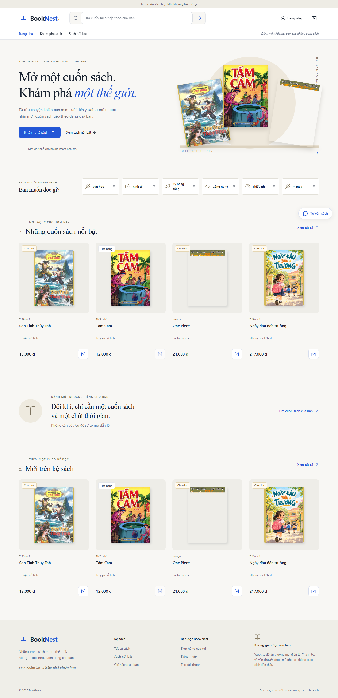
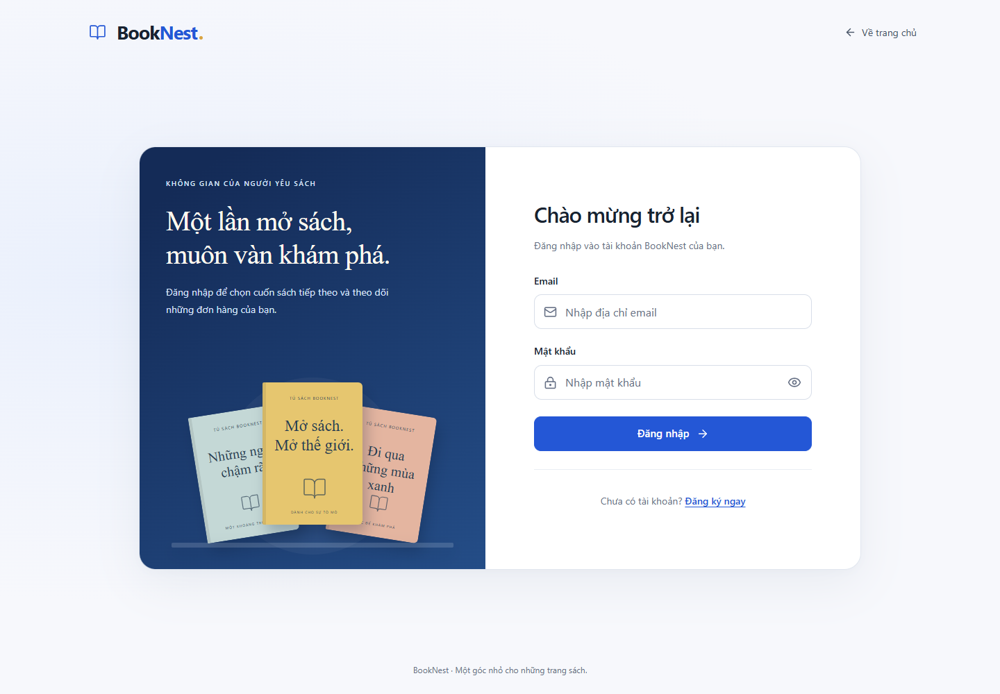
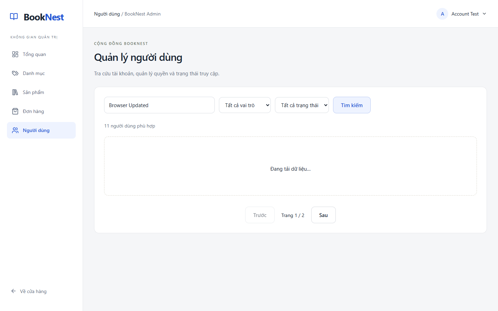

# BookNest — Không gian sách của bạn

Ứng dụng thương mại điện tử bán sách với giao diện tiếng Việt, xây dựng bằng **Vue 3, TypeScript, ASP.NET Core 8 và MariaDB**. BookNest có không gian mua sắm dành cho khách hàng, trang quản trị riêng và API lưu trữ dữ liệu thực tế.

> Dự án phục vụ học tập và trình diễn. Sách/ảnh bìa seed là dữ liệu minh họa; thanh toán và vận chuyển được mô phỏng, không phát sinh giao dịch tiền thật.

## Giao diện

### Trang chủ



### Đăng nhập



### Quản lý người dùng



Ảnh quản lý người dùng sử dụng tài khoản thử nghiệm. Thêm ảnh hồ sơ và các kích thước responsive trong `docs/screenshots/`.

## Chức năng

### Khách hàng

- Đăng ký, đăng nhập, đăng xuất; quay lại checkout sau khi đăng nhập.
- Khám phá sách, xem chi tiết, tìm kiếm, lọc/sắp xếp và phân trang phía server.
- Giỏ hàng lưu cục bộ; kiểm tra lại giá và tồn kho từ API.
- Đặt hàng với thông tin người nhận riêng cho từng đơn; idempotency key giúp hạn chế tạo đơn trùng khi thử lại request.
- Mô phỏng thanh toán thành công/thất bại, theo dõi và hủy đơn theo quy tắc nghiệp vụ.
- Viết/sửa đánh giá khi đã hoàn thành mua hàng.
- Cập nhật họ tên, số điện thoại và địa chỉ mặc định; tên trên header thay đổi ngay sau khi lưu.
- Đổi mật khẩu và đăng nhập lại, không mất giỏ hàng.

### Quản trị viên

- Dashboard doanh thu, thống kê và đơn hàng gần đây.
- Quản lý danh mục, sản phẩm, giá, tồn kho, trạng thái hiển thị và ảnh bìa.
- Theo dõi đơn hàng, cập nhật trạng thái theo luồng cho phép.
- Tìm người dùng theo họ tên/email, lọc vai trò/trạng thái và phân trang server.
- Xem chi tiết tài khoản, tổng đơn, tổng chi tiêu từ đơn **Completed + Paid**, đơn gần đây có liên kết sang chi tiết.
- Khóa/mở khóa và chuyển vai trò Customer/Admin với xác nhận và lịch sử thao tác.
- Backend chặn tự khóa/tự đổi vai trò; bảo vệ Admin hoạt động cuối cùng bằng transaction và khóa hàng MariaDB.

Không bổ sung xóa vĩnh viễn người dùng, Admin tạo tài khoản hoặc sửa mật khẩu/thông tin cá nhân thay người khác trong phạm vi hiện tại.

### Hồ sơ và bảo mật phiên đăng nhập

- Customer: `/account/profile`; Admin: `/admin/profile`. Email, vai trò và ngày tham gia chỉ đọc.
- Checkout khởi tạo bằng thông tin mặc định nhưng ưu tiên dữ liệu đã khôi phục, không tự ghi đè nội dung đang nhập. Đơn cũ giữ nguyên thông tin nhận hàng.
- JWT chứa `auth_version`; request xác thực kiểm tra trạng thái, phiên bản và vai trò hiện tại trong database.
- Khóa tài khoản, đổi vai trò hoặc đổi mật khẩu thu hồi token cũ. Mở khóa không khôi phục token đã thu hồi.
- Token thiếu claim phiên bản yêu cầu đăng nhập lại. Đổi mật khẩu giới hạn **5 request/người dùng/phút**.

### Chatbot tư vấn sách

Tích hợp REST Gemini ở backend, cấu hình tùy chọn. Khi chưa cấu hình hoặc dịch vụ không sẵn sàng, ứng dụng hiển thị lỗi phù hợp; các chức năng mua sắm vẫn hoạt động.

## Công nghệ

| Thành phần | Công nghệ |
| --- | --- |
| Frontend | Vue 3 Composition API, TypeScript, Vite 7 |
| Điều hướng và state | Vue Router 4, Pinia 3 |
| UI | CSS tùy chỉnh, Tailwind CSS 4, Lucide, Chart.js |
| HTTP client | Axios |
| Backend | ASP.NET Core 8 Web API, C# |
| Database | MariaDB, Entity Framework Core 8, Pomelo |
| Xác thực | JWT Bearer, ASP.NET PasswordHasher |
| API documentation | Swagger / OpenAPI |
| Xử lý ảnh | SkiaSharp |
| Kiểm thử | xUnit, WebApplicationFactory, MariaDB riêng, Playwright + Chrome |

Dependency được khai báo trong project files và lockfile frontend. Backend target `net8.0`.

## Cấu trúc dự án

```text
BookNest/
├── BookNest.sln
├── backend/
│   ├── BookNest.Api/
│   │   ├── Controllers/       # REST API
│   │   ├── Data/              # DbContext và seed Development
│   │   ├── DTOs/              # Request/response contracts
│   │   ├── Entities/          # Mô hình dữ liệu
│   │   ├── Infrastructure/    # Xử lý lỗi và hạ tầng
│   │   ├── Migrations/        # EF Core migrations
│   │   ├── Services/          # Đơn hàng, dashboard, AI
│   │   └── wwwroot/           # Ảnh bìa và upload local
│   └── BookNest.Tests/        # Kiểm thử API/nghiệp vụ
├── frontend/src/
│   ├── api/                   # Axios client
│   ├── assets/
│   ├── components/
│   ├── layouts/               # Shop, Admin, Auth
│   ├── router/
│   ├── stores/                # Pinia auth/cart
│   ├── types/
│   ├── utils/
│   └── views/                 # Shop, Auth, Admin, Account
├── scripts/                   # Thiết lập và kiểm thử
└── docs/                      # Thiết kế, checklist, ảnh giao diện
```

## Cài đặt và chạy local

Hướng dẫn sử dụng **PowerShell trên Windows**. Thực hiện từ thư mục gốc của bản clone, trừ khi có chỉ dẫn khác.

### 1. Chuẩn bị môi trường

- .NET SDK 8 và ASP.NET Core Runtime 8.
- Node.js tương thích Vite 7: **20.19+ hoặc 22.12+**, kèm npm.
- MariaDB đang chạy; môi trường phát triển đã kiểm tra với **MariaDB 10.4.32** trong XAMPP.
- Git để clone/push repository.
- Google Chrome nếu chạy bộ kiểm thử trình duyệt hiện có.

Nếu dùng XAMPP, khởi động dịch vụ **MySQL** (MariaDB) trong Control Panel. Không cần chạy Apache/PHP.

Sau khi clone repository và mở thư mục dự án:

```powershell
dotnet tool restore
dotnet restore .\BookNest.sln
Push-Location .\frontend
npm ci
Pop-Location
```

### 2. Cấu hình local

**Cách A — dùng script Windows/XAMPP:**

```powershell
.\scripts\Setup-Local.ps1
# Nếu database yêu cầu mật khẩu:
# .\scripts\Setup-Local.ps1 -PromptDatabasePassword
# Nếu không dùng đường dẫn XAMPP mặc định, truyền cổng đã xác nhận:
# .\scripts\Setup-Local.ps1 -Port 3306 -PromptDatabasePassword
```

Script tạo `backend/BookNest.Api/appsettings.Local.json`, sinh JWT secret và mật khẩu demo ngẫu nhiên, không in secrets ra terminal và từ chối ghi đè cấu hình có sẵn. Nếu không truyền `-Port`, script đọc cổng từ `C:\xampp\mysql\bin\my.ini`.

**Cách B — tự cấu hình:**

```powershell
Copy-Item .\backend\BookNest.Api\appsettings.Local.example.json `
          .\backend\BookNest.Api\appsettings.Local.json
```

Mở file vừa tạo và thay các placeholder:

| Khóa | Ý nghĩa |
| --- | --- |
| `ConnectionStrings:BookNest` | Host, port, database, user và mật khẩu MariaDB |
| `Jwt:Secret` | Chuỗi ngẫu nhiên đủ mạnh, ít nhất 32 byte |
| `Seed:AdminPassword` | Mật khẩu Admin demo, ít nhất 8 ký tự |
| `Seed:CustomerPassword` | Mật khẩu Customer demo, ít nhất 8 ký tự |
| `AI_PROVIDER` | `Gemini` nếu dùng chatbot |
| `AI_API_KEY` | API key backend; có thể để trống khi chưa dùng AI |
| `AI_MODEL` | Tên model mà API key được phép truy cập |

File local được `.gitignore` loại trừ. **Không commit file này hoặc đưa key/JWT secret vào frontend.** Không dùng DB root không mật khẩu cho môi trường public.

Có thể dùng environment variables (`ConnectionStrings__BookNest`, `Jwt__Secret`, `AI_API_KEY`, `AI_MODEL`) hoặc .NET user-secrets. Trong Development, user-secrets được nạp sau cấu hình local/environment; tránh giữ các giá trị xung đột ở nhiều nơi.

### 3. Migrations và dữ liệu demo

```powershell
$env:ASPNETCORE_ENVIRONMENT = 'Development'
dotnet run --project .\backend\BookNest.Api -- --migrate
```

Lệnh áp dụng migration rồi kết thúc. Tài khoản DB cần quyền tạo database/schema khi thiết lập lần đầu, hoặc database phải được quản trị viên tạo và cấp quyền trước.

**Chỉ với database demo mới**, tạo dữ liệu trình diễn:

```powershell
dotnet run --project .\backend\BookNest.Api -- --seed
```

Seed chỉ cho phép trong Development, cũng áp dụng migrations, rồi tạo **5 danh mục, 25 sách minh họa, 2 tài khoản và 5 đơn demo**. Đơn demo đi qua nghiệp vụ đặt hàng/thanh toán, có sử dụng tồn kho. Seed kiểm tra dữ liệu đã tồn tại để tránh trùng và không đổi mật khẩu tài khoản cũ.

> Database đã có dữ liệu: chỉ áp dụng migration cần thiết, không reset/drop hoặc seed lại để nâng cấp. Với schema từ nguồn khác, cần kiểm tra tương thích trước. Migration hồ sơ/người dùng giữ dữ liệu hiện có, đặt tài khoản cũ ở trạng thái hoạt động; JWT cũ thiếu claim phiên bản cần đăng nhập lại.

### 4. Chạy backend

Terminal thứ nhất, tại thư mục gốc:

```powershell
$env:ASPNETCORE_ENVIRONMENT = 'Development'
dotnet run --project .\backend\BookNest.Api --urls http://localhost:5080
```

| Dịch vụ | Địa chỉ local |
| --- | --- |
| API | `http://localhost:5080/api` |
| Health check | `http://localhost:5080/api/health` |
| Swagger (Development) | `http://localhost:5080/swagger` |

### 5. Chạy frontend

Terminal thứ hai, tại thư mục gốc:

```powershell
Set-Location .\frontend
npm run dev
```

Mở **`http://localhost:5173`**. Vite proxy `/api`, `/uploads`, `/images` sang backend cổng 5080. Đổi cổng backend cần sửa proxy tương ứng trong cấu hình Vite.

### Tài khoản demo

Chỉ có sau khi seed trên database demo:

| Vai trò | Email | Mật khẩu |
| --- | --- | --- |
| Admin | `admin@booknest.local` | `Seed.AdminPassword` khi tạo tài khoản |
| Customer | `customer@booknest.local` | `Seed.CustomerPassword` khi tạo tài khoản |

Không công khai mật khẩu dùng chung. Sửa cấu hình seed không đổi mật khẩu tài khoản đã tồn tại; sau khi đổi mật khẩu trong hồ sơ, dùng mật khẩu mới.

## Luồng đơn hàng

1. Khách thêm sách vào giỏ → checkout → đăng nhập nếu cần → quay lại checkout.
2. Backend kiểm tra giá/tồn, tạo **Pending + Unpaid** và trừ tồn trong transaction.
3. Customer mô phỏng thanh toán; có thể thử lại khi thất bại.
4. Với đơn Paid, Admin chuyển **Pending → Shipping → Completed**.
5. Đơn Pending chưa Paid có thể hủy; hoàn tồn theo quy tắc và không hoàn trùng.
6. Customer đủ điều kiện đánh giá sau khi hoàn thành mua. Dashboard tính doanh thu từ đơn **Completed + Paid**.

## API chính

Swagger cung cấp request/response và chức năng thử API. Các nhóm endpoint tiêu biểu:

| Nhóm | Endpoint |
| --- | --- |
| Xác thực | `/api/auth/register`, `/api/auth/login`, `/api/auth/me` |
| Catalog | `/api/products`, `/api/categories` |
| Đơn hàng | `/api/orders` |
| Hồ sơ | `GET /api/account/profile`, `PUT /api/account/profile` |
| Đổi mật khẩu | `POST /api/account/change-password` |
| Người dùng Admin | `GET /api/admin/users`, `GET /api/admin/users/{id}` |
| Trạng thái/vai trò | `PATCH /api/admin/users/{id}/status`, `PATCH /api/admin/users/{id}/role` |
| Quản trị khác | `/api/admin/dashboard`, `/api/admin/products`, `/api/admin/categories`, `/api/admin/orders` |

API quản trị yêu cầu Admin và phiên xác thực hợp lệ trong database. API hồ sơ lấy UserId từ danh tính xác thực, không nhận UserId tùy ý. Response không trả PasswordHash hoặc phiên bản xác thực nội bộ.

## Cấu hình Gemini — tùy chọn

1. Đặt `AI_API_KEY` ở backend qua file local, environment hoặc user-secrets.
2. Lấy danh sách model được tài khoản cho phép:

   ```powershell
   .\scripts\List-AiModels.ps1
   ```

3. Điền đúng tên model hỗ trợ `generateContent` vào `AI_MODEL`, rồi khởi động lại backend.

Không đặt key trong biến `VITE_*`, source frontend hoặc repository. Context AI chỉ dùng catalog, không gửi hồ sơ, email, địa chỉ hoặc lịch sử đơn hàng. **Chưa xác minh cuộc gọi Gemini thật bằng API key trong đợt kiểm thử được ghi nhận.** Nội dung AI cần được người dùng kiểm tra lại.

## Build và kiểm thử

### Build

Dừng API trước khi build trên Windows nếu gặp lỗi khóa DLL/executable; không cần dừng MariaDB.

```powershell
dotnet build .\BookNest.sln
Push-Location .\frontend
npm run type-check
npm run build
Pop-Location
```

### Kiểm thử API với MariaDB riêng

```powershell
.\scripts\Test-MariaDb.ps1
```

Script đọc kết nối local, tạo database `booknest_test_<GUID>` riêng cho từng lượt, áp dụng migrations và chạy xUnit. Test host từ chối tên không đúng prefix. Script hiện yêu cầu kết nối local chứa `Database=booknest_db;` để thay tên database; tài khoản DB cần quyền tạo database test.

- Không dùng EF InMemory thay cho kiểm thử transaction MariaDB.
- Không khóa/đổi quyền/đổi mật khẩu tài khoản thật để kiểm thử.
- Database test được giữ lại, không tự DROP; chỉ dọn thủ công sau khi xác nhận đúng tên.
- Báo cáo TRX: `TestResults/business.trx`.
- Không xem `dotnet test` thiếu cấu hình database riêng là một lượt kiểm thử MariaDB thành công.

### Kiểm thử trình duyệt

Script hiện dùng Playwright trong `.local` và Chrome tại `C:\Program Files\Google\Chrome\Application\chrome.exe`. Cài dependency riêng, không cần thêm vào frontend:

```powershell
npm install --prefix .\.local playwright@1.56.1 --no-audit --no-fund
```

Với frontend/backend đang chạy, các lượt hồi quy sau không tạo đơn hoặc sửa dữ liệu server:

```powershell
node .\scripts\auth-regression.cjs
node .\scripts\ui-regression.cjs
node .\scripts\catalog-regression.cjs
node .\scripts\catalog-regression.cjs --fixtures
```

`ui-regression.cjs` dùng tài khoản demo đã seed và mật khẩu trong cấu hình local. Auth regression dùng fixture lỗi/loading; catalog `--fixtures` chặn dữ liệu ở trình duyệt, không phải xác nhận API thật.

Để kiểm tra hồ sơ, người dùng và đổi mật khẩu qua trình duyệt với **database thử nghiệm thật**, để Vite chạy tại cổng 5173 rồi chạy:

```powershell
$env:BOOKNEST_BROWSER_TEST = '1'
try {
    .\scripts\Test-MariaDb.ps1
} finally {
    Remove-Item Env:BOOKNEST_BROWSER_TEST -ErrorAction SilentlyContinue
}
```

Harness tạo tài khoản test, chạy API riêng tại cổng **5081**, gọi `account-regression.cjs`, rồi dừng API thử nghiệm. Cổng 5081 phải trống. Không gọi trực tiếp script này bằng token tài khoản thật.

> **Cảnh báo:** `scripts/browser-smoke.cjs` cũ có tạo đơn, mô phỏng thanh toán và thay đổi tồn kho. Không dùng cho kiểm thử read-only hoặc trên database đang sử dụng thực tế.

### Kết quả đã ghi nhận

- **26/26 test qua** khi bật cả browser harness trên MariaDB riêng.
- Backend build, frontend type-check và production build thành công.
- Kiểm tra phân quyền/ownership, chặn trường đặc quyền, lọc/phân trang, audit và tổng chi tiêu.
- Kiểm tra đồng thời thao tác Admin, thu hồi JWT sau khóa/đổi quyền/đổi mật khẩu, mở khóa không khôi phục token cũ.
- Kiểm tra header cập nhật sau lưu hồ sơ, checkout giữ dữ liệu, đổi mật khẩu giữ giỏ và rate limit trả 429.
- Hồ sơ/quản lý người dùng ở 1440/768/390px; bảng cuộn độc lập, không tràn ngang toàn trang.
- Hồi quy auth, storefront/Admin và catalog qua các viewport tương ứng; fixture/API thật được ghi riêng trong báo cáo.

Chi tiết trong `docs/account-management.md`, `docs/ui-refresh.md` và `docs/screenshots/`. Kết quả này không thay thế audit bảo mật hoặc khả năng truy cập đầy đủ.

## Bảo mật và giới hạn

- Mật khẩu băm bằng PasswordHasher; DTO tách riêng; backend kiểm tra quyền, ownership và whitelist vai trò.
- Audit quyền/trạng thái không chứa mật khẩu, hash hoặc token. Không bật HTTP body logging chứa mật khẩu hoặc EF sensitive-data logging.
- Access token trong Pinia/sessionStorage vẫn có rủi ro khi XSS. Chưa có refresh token hoặc session bằng HttpOnly cookie.
- Checkout lưu payload chờ xác nhận trong sessionStorage để retry an toàn, có thông tin người nhận. Không lưu mật khẩu trong URL/storage.
- Chưa có xác minh email, quên mật khẩu, đổi email, upload avatar, social login, mã giảm giá hoặc wishlist.
- Chưa có thanh toán/vận chuyển/hoàn tiền thật, tự hết hạn đơn Pending, tìm kiếm full-text hoặc vector database.
- Chưa kiểm thử thiết bị di động vật lý, password manager thực tế, screen reader đầy đủ, pen-test hoặc tải đa API instance.
- Upload local dùng SkiaSharp; Linux cần kiểm tra native assets tương ứng. Cần backup database và thư mục upload khi triển khai.
- Production cần HTTPS, secrets an toàn, DB user quyền tối thiểu, cấu hình host/CORS và reverse proxy. Build frontend không có Vite dev proxy: cần phục vụ `/api`, `/uploads`, `/images` qua reverse proxy, hoặc cấu hình API public và đường dẫn ảnh phù hợp. `VITE_API_BASE_URL` chỉ chứa URL public, không chứa secrets.

## Tài liệu bổ sung

| File | Nội dung |
| --- | --- |
| `docs/account-management.md` | Hồ sơ/người dùng, JWT revocation, migration và kiểm thử |
| `docs/ui-refresh.md` | Nâng cấp UI và bằng chứng responsive |
| `docs/database.md` | Thiết kế database |
| `docs/order-rules.md` | Đơn hàng, thanh toán và tồn kho |
| `docs/api.md` | Ghi chú API; đối chiếu Swagger khi chạy |
| `docs/technology.md` | Ghi chú công nghệ |
| `docs/acceptance-checklist.md` | Checklist nghiệm thu |

Một số tài liệu lịch sử mô tả theo từng mốc phát triển; phần hồ sơ/người dùng mới được ghi riêng trong `docs/account-management.md`.

## Trước khi đẩy lên GitHub

- Kiểm tra `git status` và nội dung staged trước khi push.
- Không đưa `appsettings.Local.json`, API key, connection string có mật khẩu hoặc token vào Git, kể cả ảnh chụp và lịch sử commit.
- `.gitignore` đã loại trừ cấu hình local, `.local`, log, `node_modules`, build output, `TestResults` và thư mục upload.
- Rà lại ảnh/tài liệu muốn công khai; chỉ dùng dữ liệu demo/thử nghiệm.
- Nếu secret từng được commit, cần thu hồi/thay secret và xử lý lịch sử Git; thêm `.gitignore` không xóa được secret khỏi lịch sử.
